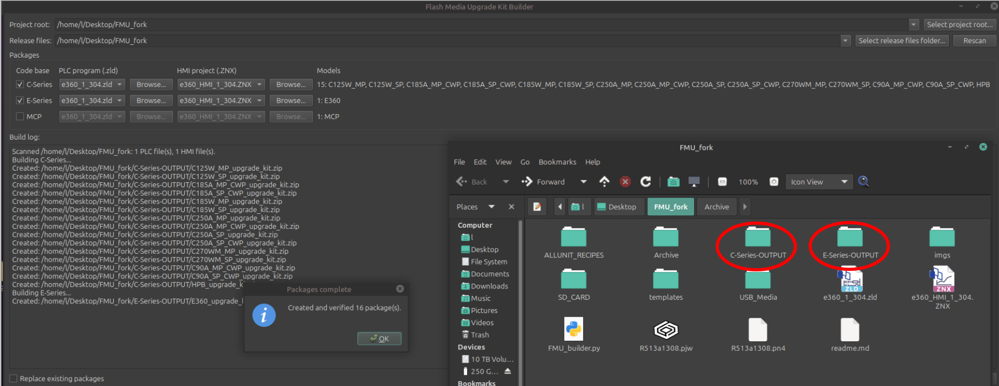

########################################################################

                      Flash Media Updates_builder

                  Builds Flash media update packages. 

########################################################################
# Flash Media Upgrade Kit Builder

Flash Media Upgrade Kit Builder creates ready-to-use upgrade packages for
C-Series, E-Series, and MCP products.

It combines the selected PLC program, HMI project, product recipes, and required
USB or SD card files into a separate ZIP package for each supported model.



## Using the Program

1. Select the **Project root** containing the templates and
   `ALLUNIT_RECIPES` folder.
2. Select the folder containing the release `.zld` and `.ZNX` files.
3. Check the product families you want to build.
4. Select the PLC and HMI files for each product family.
5. Review the detected models.
6. Click **Build Packages**.

The completed packages are placed in the appropriate output folder:

- `C-Series-OUTPUT`
- `E-Series-OUTPUT`
- `MCP-OUTPUT`

Each model receives its own ZIP file.

Enable **Replace existing packages** when rebuilding packages that already
exist.

## Recipe Files

Recipes are copied from `ALLUNIT_RECIPES` into a `{UNIT}_RECIPES` folder inside
each package.

The original files in `ALLUNIT_RECIPES` are not modified.

## Running From Source

The application requires Python 3 and PySide6.

```bash
python3 FMU_builder.py
```

OR

Look for your platform in the RELEASES folder.
<pre>
FMU_builder     --> Linux (Mint) executable

FMU_builder.exe --> Windows executable


Put your executable of choice in the main project folder, 
and run on your desired platform.
</pre>


TODO/FIX:

    Documents in templates folder

```bash
# Build Notes:

$ pyinstaller \
    --noconfirm \ 
    --clean \
    --onefile \ 
    --windowed \
    --name FMU_Builder \     
    FMU_builder.py

```
