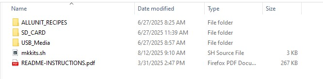
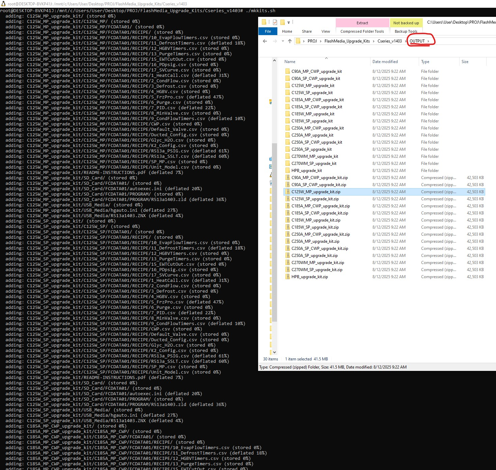

 Notes:  
 What you need for this script to run nice: 
 Your Series README.pdf in the same dir 
 USB_Media dir with *.ZNX and configured hgauto.ini  
 SD_Card dir with *.zld in FCDATA01/PROGRAM and configured autoexec.ini in FCDATA01 
 A dir named ALLUNIT_RECIPES with all unit recipies  
This Repo contains ALLUNIT_RECIPES  
BE CAUTIOUS AS RECIPES COULD CHANGE 
Make sure you are using the proper recipes 
 
What that looks like: 

 
Script execution is using bash in windows WSL. 
$ ./mkkits.sh 
  
what happens next is all the recipes in ALL_RECIPES (c-series) are congregated by type respectively, 
and packaged. run.jpg shows what script ouptut looks like on the left, and folder OUTPUT/ on the right. 
the zipped packages are the flash media upgrade kits.  

